# Documentation

FCA-Based Concept Drift Detection is a Python project for detecting changes in data streams through Formal Concept Analysis (FCA). It builds formal concept lattices from sliding windows, compares successive lattices, and analyzes the resulting change signal to identify drift events.

## Guides

- [Quick Start](quickstart.md) — install the project and run an experiment.
- [Configuration](configuration.md) — reference for configuration templates and runtime parameters.
- [API Reference](api.md) — overview of the main Python modules and interfaces.
- [Windows Executable](binaries.md) — build and run a standalone executable with PyInstaller.

For a project overview and technology stack, see the [main README](../README.md).

## Processing Architecture

```mermaid
graph LR
    A[StreamReader] --> B[StreamWrapper]
    B --> C[SlidingWindow]
    C --> D[DataPreprocessor]
    D --> E[FormalContext]
    E --> F[ConceptLattice]
    F --> G[LatticeSimilarityCalculator]
    G --> H[FCADriftDetector]
    H --> I[DriftAggregatorV2]
    I --> J[Reports and Plots]
```

The application processes incoming observations in windows, binarizes their attributes, and constructs a formal context for each window. It then generates a concept lattice and compares it with the previous lattice. Drift events can be aggregated and represented in reports and plots.

## Lattice Change Signal

The dissimilarity between consecutive lattices is defined as:

$$
\Delta L_t = 1 - S(L_{t-1}, L_t)
$$

The similarity measure combines concept, hierarchy, and structural components:

$$
S(L_1, L_2) = \alpha S_c + \beta S_h + \gamma S_s
$$

Here, $S_c$ denotes concept similarity, $S_h$ hierarchy similarity, and $S_s$ structural similarity. These weights belong to the lattice-similarity calculation and are distinct from the detector's `--alpha` threshold parameter.

## Module Overview

| Package | Responsibility |
| --- | --- |
| `core` | Stream sources, sliding windows, and preprocessing |
| `fca` | Formal contexts, concept lattices, and similarity computation |
| `detection` | FCA-based drift detection and reference detectors |
| `evaluation` | Precision, recall, F1-score, and detection delay |
| `experiments` | Parameter search and detector comparison |
| `history` | Lattice snapshots and historical comparisons |
| `utils` | Logging, drift-event aggregation, and result processing |
| `visualization` | Plots, report generation, and drift analysis |

The project is an experimental analysis tool. Drift detection quality depends on data characteristics and parameter selection; results should be evaluated against suitable reference points or baselines.
