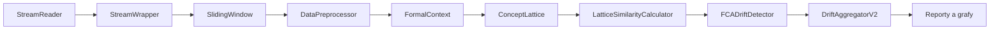

# FCA-based Concept Drift Detection System — Dokumentácia

Krátka, praktická dokumentácia k Python projektu na detekciu konceptového driftu
pomocou Formal Concept Analysis (FCA).

## Obsah

- [Rýchly štart](quickstart.md)
- [Konfigurácia](configuration.md)
- [API referencie](api.md)
- [Binarne vystupy (EXE)](binaries.md)

## Čo tento systém robí

- Spracuje dátový tok po oknách a z každej dávky vytvorí FCA mriežku.
- Porovnáva mriežky v čase a vytvára signál zmeny.
- Deteguje a agreguje drift epizódy, pripraví reporty a grafy.

## Architektúra spracovania

## Signál driftu

Podstata signálu je pokles podobnosti medzi dvoma po sebe idúcimi mriežkami:

$$\Delta L_t = 1 - S(L_{t-1}, L_t)$$

Vnútorná podobnosť mriežok je kombinácia viacerých zložiek:

$$S(L_1, L_2) = \alpha S_c + \beta S_h + \gamma S_s$$

kde $S_c$ je podobnosť konceptov, $S_h$ hierarchie a $S_s$ štruktúry.

## Kľúčové balíky

- `core`: dátové toky, okná a binarizácia.
- `fca`: formálny kontext, koncepty a mriežka.
- `detection`: FCA detektor a baseline detektory.
- `evaluation`: metriky (precision, recall, F1, delay).
- `experiments`: grid search a porovnania.
- `history`, `utils`, `visualization`: agregácia epizód a reporty.
